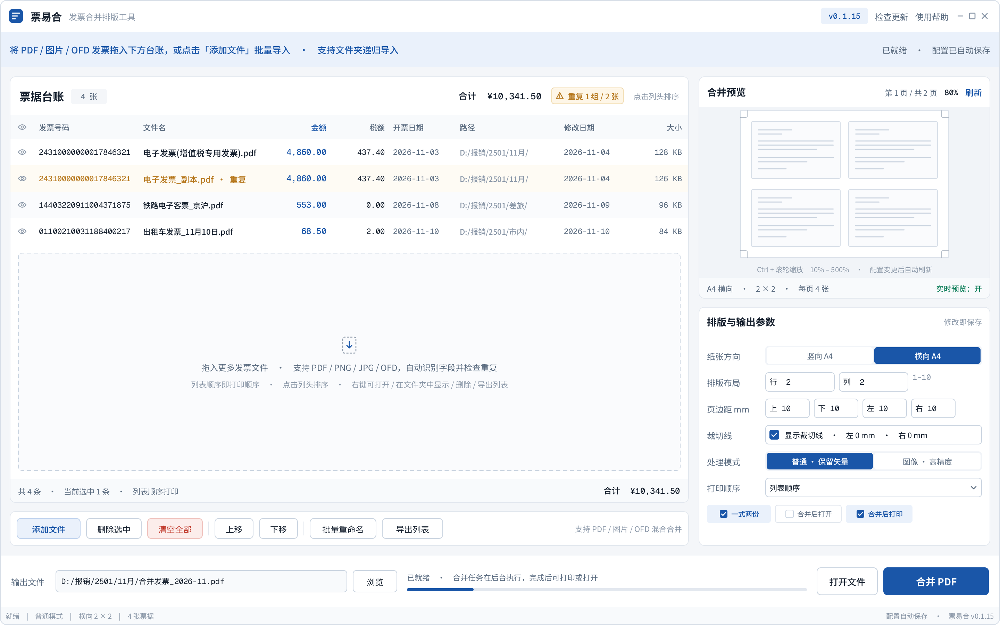

# 票易合 - 项目说明文档

## 一、项目规划

### 1.1 项目概述

票易合是一款基于 Python + PySide6 开发的跨平台桌面应用程序，专门用于将多张发票 PDF 文件合并排版成指定格式，支持批量重命名功能。同时，项目已集成 **MCP Server** 能力，使 AI 客户端（如 Claude Desktop、Cursor 等）能够通过标准 MCP 协议调用票易合的核心功能。

### 1.2 技术架构

- **前端框架**: PySide6 (Qt 跨平台 GUI 框架)
- **PDF 处理**: PyMuPDF (fitz)
- **MCP 协议**: 官方 `mcp` Python SDK + FastMCP
- **编程语言**: Python 3
- **打包工具**: PyInstaller

### 1.3 核心功能模块

1. **PDF合并排版**: 支持多种布局模式（横向2x2、横向2x4、竖向1x2、竖向1x3、竖向2x4），支持 PDF、图片（png/jpg/jpeg）与 OFD 发票混合合并
2. **批量重命名**: 按发票类型分别配置重命名规则，每种票种有自己的一套可插入字段
3. **发票字段识别**: 自动识别发票类型、金额、日期、购买方、销售方等信息，并支持各票种特有字段（车次、航班号、车牌号等）
4. **MCP Server**: 提供标准 MCP 协议接口，支持 AI 客户端远程调用合并、提取、重命名、导出等能力

***

## 二、实施方案

### 2.1 发票字段提取重构（已完成 - 2026-04-29）

#### 重构背景

原发票字段提取代码采用集中式大方法设计，所有票种的提取逻辑混合在一起，导致：

- 修改A票种的识别规则时，容易意外影响B票种
- 代码可读性差，难以维护
- 新增票种需要修改多处代码

#### 重构方案

采用**策略模式（Strategy Pattern）** + \*\*工厂模式（Factory Pattern）\*\*进行重构：

```
code/core/
├── pdf_handler.py                    # 保留合并功能，字段提取委托给提取器
└── invoice_extractors/               # 发票提取器模块
    ├── __init__.py
    ├── base.py                       # InvoiceExtractor 抽象基类
    ├── factory.py                    # InvoiceExtractorFactory 工厂类
    ├── common_invoice.py             # 普通发票提取器（兜底）
    ├── train_ticket.py               # 火车票提取器
    ├── flight_ticket.py              # 飞机票提取器
    ├── vehicle_invoice.py            # 机动车发票提取器
    ├── taxi_invoice.py               # 出租车发票提取器
    ├── fixed_amount_invoice.py       # 定额发票提取器
    └── toll_invoice.py               # 通行费发票提取器
```

#### 核心优势

1. **隔离性**：每种票种的提取逻辑完全独立，修改A票种不会影响B票种
2. **可扩展性**：新增票种只需添加新的提取器类，无需修改现有代码（开闭原则）
3. **可测试性**：每种票种的提取器可以独立单元测试
4. **可读性**：每个类的职责单一，代码结构清晰

#### 支持的票种

| 票种         | 提取器类                        | 识别关键词                 |
| ---------- | --------------------------- | --------------------- |
| 增值税普通/专用发票 | CommonInvoiceExtractor      | "发票"（兜底）              |
| 火车票/铁路电子客票 | TrainTicketExtractor        | "火车票", "铁路电子客票"       |
| 飞机票/航空电子客票 | FlightTicketExtractor       | "航空", "机票", "电子客票行程单" |
| 机动车/二手车发票  | VehicleInvoiceExtractor     | "机动车", "二手车"          |
| 出租车发票      | TaxiInvoiceExtractor        | "出租车", "出租汽车"         |
| 定额发票       | FixedAmountInvoiceExtractor | "定额发票"                |
| 通行费/ETC发票  | TollInvoiceExtractor        | "通行费", "ETC", "过路费"   |

#### 提取字段

- `amount` - 金额
- `invoice_date` - 开票日期
- `invoice_type` - 发票类型
- `product_type` - 商品类型
- `buyer_name` - 购买方名称
- `seller_name` - 销售方名称
- `invoice_code` - 发票号码
- `tax_amount` - 税额
- `invoice_type_key` - 票种标识（用于按票种选择重命名规则）
- 各票种特有字段：`train_number`/`departure_station`/`arrival_station`（火车票）、`flight_number`/`airline`（飞机票）、`plate_number`（出租车）、`vin`（机动车）、`toll_entry`/`toll_exit`/`toll_section`（通行费）

***

### 2.2 按发票类型的重命名规则（已完成 - 2026-11-12）

#### 背景

原重命名只有一条全局规则（`config.json` 的单一 `rename_rule`），所有票种共用一份字段清单。但不同票种能拿到的字段差异很大：火车票有车次和出发/到达站，飞机票有航班号，出租车有车牌号，定额发票连买方都没有。用一条规则覆盖全部票种，票种特有信息只能被浪费。

#### 方案

重命名规则按发票类型分套存储与执行：

| 票种 | 标识 | 独有可插入字段 | 默认模板（仅提示） |
| --- | --- | --- | --- |
| 增值税发票 | `vat_invoice` | 商品类型、买方名字、销方名字 | `{开票日期}-{买方名字}-{金额}` |
| 火车票 | `train_ticket` | 买方名字、车次、出发站、到达站 | `{开票日期}-{车次}-{出发站}到{到达站}` |
| 飞机票 | `flight_ticket` | 买方名字、销方名字、航班号、航空公司 | `{开票日期}-{航班号}-{航空公司}` |
| 机动车发票 | `vehicle_invoice` | 商品类型、买方名字、销方名字、车架号 | `{开票日期}-{车架号}` |
| 出租车发票 | `taxi_invoice` | 销方名字、车牌号 | `{开票日期}-{车牌号}-{金额}` |
| 定额发票 | `fixed_amount_invoice` | 无（仅通用四项） | `{开票日期}-{金额}` |
| 通行费发票 | `toll_invoice` | 商品类型、买方名字、销方名字、入口、出口、路段 | `{开票日期}-{入口}到{出口}` |

全部票种通用字段：发票类型、开票日期、发票号码、金额。

#### 关键行为

1. **按文件识别出的票种选规则**：混合列表里火车票、增值税发票各按自己的规则改名。
2. **未配置规则的票种跳过**：某票种规则为空时，该票种文件保持原名，重命名结果提示"跳过未配置规则的 N 个文件"。
3. **未识别字段保留占位符**：字段取不到值时，文件名中保留 `{占位符}` 原文，便于肉眼看出未识别。
4. **对话框内按票种切换**：左侧标签页（tab）常驻列出 7 类票种，点击即切换分别配置；不使用展开式下拉框，避免弹出层遮挡字段按钮。输入框中的模板是**建议起点**，需点击「保存」后才生效；切换票种前未保存的修改会丢失。
5. **旧配置自动迁移**：升级时把原 `rename_rule` 复制到全部 7 类票种，保证升级前后重命名行为不变。

#### 配置文件结构

```json
{
  "rename_rules": {
    "vat_invoice": "{开票日期}-{买方名字}-{金额}",
    "train_ticket": "{开票日期}-{车次}-{出发站}到{到达站}",
    "flight_ticket": "",
    "vehicle_invoice": "",
    "taxi_invoice": "",
    "fixed_amount_invoice": "",
    "toll_invoice": ""
  }
}
```

空字符串表示该票种未配置规则。

#### 实测比对

新增 `scripts/compare_invoice_fields.py`，用真实发票目录校验字段提取：

```bash
python scripts/compare_invoice_fields.py
python scripts/compare_invoice_fields.py --source-dir D:\path\to\invoices
```

- 脚本**不依赖 PyMuPDF**：PDF 解析由被测代码完成，脚本本身只用标准库读写 JSON。
- 期望值来自基线 `openspec/changes/per-invoice-type-rename-rules/baseline/expected-fields.json`，由人工读取票面文本整理，**不由被测代码生成**。
- 样本目录默认 `D:\minipro\piaoyihe\piaoyihe_test`（在仓库之外，不进版本控制）。

**覆盖缺口（必须知悉）**：真实样本覆盖 3/7 类票种（增值税发票、火车票、飞机票）。**机动车发票、出租车发票、定额发票、通行费发票无真实样本**，其提取逻辑仅由构造文案的单元测试覆盖，不计入实测通过。

***

### 2.2 MCP Server 集成（已完成 - 2026-07-19）

#### 集成背景

随着 AI 助手和自动化工具的普及，用户希望票易合的核心能力能够被外部 AI 客户端调用。通过集成 MCP（Model Context Protocol）Server，可以将发票合并、字段提取、批量重命名、导出 Excel 等能力以标准协议暴露给 Claude Desktop、Cursor 等客户端。

#### 集成方案

1. **引入官方** **`mcp`** **Python SDK**：使用 `FastMCP` 框架快速实现协议层。
2. **抽象业务服务层**：新增 `code/core/invoice_service.py`，将重命名、导出等 UI 耦合逻辑解耦为独立服务。
3. **新增 MCP Server 模块**：在 `code/mcp_server/` 中实现 Tools、Server、配置和命令行入口。
4. **扩展程序入口**：`code/main.py` 支持 `--mcp-server` 参数，可选择 stdio 独立模式或 sse 与 GUI 共存模式。

#### 运行方式

```bash
# 命令行独立模式（stdio，推荐用于 Claude Desktop）
python -m code.mcp_server

# SSE 独立模式
python -m code.mcp_server --transport sse --host 127.0.0.1 --port 8766

# GUI 共存模式
python code/main.py --mcp-server --transport sse --host 127.0.0.1 --port 8766
```

##### 命令行参数

| 参数               | 说明                   | 默认值         |
| ---------------- | -------------------- | ----------- |
| `--transport`    | 传输方式，`stdio` 或 `sse` | `stdio`     |
| `--host`         | SSE 模式监听地址           | `127.0.0.1` |
| `--port`         | SSE 模式监听端口           | `8765`      |
| `--cors-origins` | SSE 模式允许的 CORS 来源列表  | `*`         |

##### 环境变量

| 变量名              | 说明                                        | 默认值    |
| ---------------- | ----------------------------------------- | ------ |
| `PYYH_LOG_LEVEL` | MCP Server 日志级别（DEBUG/INFO/WARNING/ERROR） | `INFO` |

#### SSE 与 GUI 共存

在 GUI 共存模式下，Qt 主线程运行桌面应用，MCP Server 在后台线程中以 SSE 方式运行。关闭主窗口时，通过 `threading.Event` 通知 SSE 服务优雅停止，避免端口占用或资源泄漏。

#### 暴露的 MCP Tools

| Tool 名称                          | 功能                          |
| -------------------------------- | --------------------------- |
| `merge_invoices`                 | 合并多个 PDF 发票为指定布局            |
| `extract_invoice_info`           | 提取单张发票全部字段                  |
| `batch_extract_invoice_info`     | 批量提取多张发票字段                  |
| `batch_rename_invoices`          | 按规则批量重命名文件（支持 `dry_run` 预览） |
| `export_invoice_list`            | 将构造好的发票信息列表导出为 Excel        |
| `export_invoice_list_from_paths` | 按 PDF 路径列表直接导出 Excel        |
| `get_supported_layouts`          | 获取支持的布局配置                   |
| `get_supported_fields`           | 获取重命名可用字段                   |
| `get_server_info`                | 获取服务名称、版本和 Tools 列表         |

#### 错误处理

所有 Tool 统一返回包含 `success` 字段的字典：

```json
{
  "success": false,
  "message": "错误原因说明"
}
```

常见错误包括：文件不存在、非 PDF 文件、输出目录不可写、发票识别失败等。AI 客户端可通过 `message` 字段向用户展示具体原因。

#### 核心优势

1. **标准化**：遵循 MCP 协议，可被多种 AI 客户端识别和调用。
2. **解耦**：业务逻辑与 UI 解耦，便于 GUI 和 MCP 两层共用同一套实现。
3. **双模式**：既支持无 GUI 的后台服务，也支持与桌面应用共存。
4. **安全**：对输入路径进行存在性、PDF 后缀、输出目录可写性校验。
5. **可扩展**：新增 Tool 只需在 `mcp_server/tools.py` 和 `server.py` 中注册。

***

### 2.3 OFD 发票支持（已完成 - 2026-10-11）

#### 需求背景

OFD（GB/T 33190）是国家推行的版式文档格式，大量电子发票以 `.ofd` 交付。用户希望票易合能直接合并 OFD 发票，且**无需解析 OFD 内部字段**，只要把 OFD 转成图片后与原有 PDF / 图片一起排版合并即可。

#### 技术选型

采用第三方库 [ofd2pdf](https://github.com/rhq-git/ofd2pdf)（MIT，内部调用 `ofd-utility` 的 `ofd-cli` 二进制）：

- 通过 `render_ofd(ofd_path, out_dir, dpi, image_format='png')` 将 OFD 每页渲染为 PNG 图片；
- 平台 wheel 内置对应系统的 `ofd-cli`，无需本机安装 Rust；
- 支持 PyInstaller 冻结路径（`sys._MEIPASS/ofd2pdf/bin`），便于打包。

#### 实现方案

沿用项目已有的「图片即排版单元」链路，把 `.ofd` 作为「需要先转换的图片文件」接入，最小化改动：

1. **新增 `code/core/ofd_converter.py`**
   - `is_ofd_file()`：判断 `.ofd` 扩展名（大小写不敏感）；
   - `render_ofd_pages()`：调用 `ofd2pdf.render_ofd` 渲染每页 PNG，并按「绝对路径+mtime+size」的 SHA1 指纹缓存到系统临时目录 `piaoyihe_ofd_cache`，命中缓存直接复用（合并预览会高频触发合并，缓存为必需）；
   - `OfdConversionError`：统一封装「文件不存在 / 未安装 ofd2pdf / 渲染失败」异常，供上层降级处理。
2. **`code/core/pdf_handler.py`**
   - 新增 `is_supported_file()`（PDF / 图片 / OFD 统一判定）；
   - `_merge_files_into_doc` 增加 OFD 分支：先 `render_ofd_pages` 得到页面图片，再逐页复用原有图片插入逻辑（多页 OFD 每页占一个排版单元）；
   - OFD 渲染失败时打印日志并跳过该文件，不影响其余文件合并。
3. **`code/ui/file_list.py`**：`build_file_info` 对 OFD 走空字段分支（金额/税额 0.00，号码/日期为空，不触发字段提取）；单文件预览浮窗支持 OFD（渲染首页后显示）。
4. **`code/core/invoice_service.py`**：批量重命名跳过 OFD，新增 `skipped_ofd_count` 统计。
5. **`code/ui/main_frame.py`**：拖放、目录递归、文件对话框过滤器纳入 `.ofd`；重命名完成提示展示跳过的 OFD 数量。
6. **`code/mcp_server/tools.py`**：路径校验放开 PDF / 图片 / OFD 三类，GUI 与 MCP 能力对齐。
7. **依赖与打包**：`requirements.txt` 增加 `ofd2pdf>=0.0.2; sys_platform != 'darwin'`；`invoice_tool.spec` / `invoice_tool_win.spec` 通过 `collect_data_files('ofd2pdf')` 打包内置 `ofd-cli` 二进制，并补齐 hiddenimports。

#### macOS 降级策略

`ofd2pdf` 官方仅提供 Windows / Linux 平台 wheel。为保证 macOS 打包稳定，采取**降级策略**：

- `requirements.txt` 用环境标记 `sys_platform != 'darwin'` 在 macOS 跳过该依赖；
- 代码中 `from ofd2pdf import render_ofd` 位于 `try/except ImportError`，缺失时抛出 `OfdConversionError`，由合并逻辑跳过 OFD 文件并提示，其余功能（PDF / 图片合并）不受影响。

后续如需 macOS 全量支持，可自行编译 macOS 版 `ofd-cli` 并随包分发（设置 `OFD_CLI` 或放入 `ofd2pdf/bin`）。

#### 验证结果

- `python -m unittest discover -s tests -p "test_*.py"`：**49 个测试全部通过**，无回归。
- 新增 `tests/test_ofd_support.py`（12 个用例）覆盖：OFD/受支持文件判定、渲染异常处理、渲染缓存复用、OFD 空字段、重命名跳过、单页/多页 OFD 混合合并、渲染失败降级、MCP 路径校验。
- **真实 OFD 端到端验证（2026-10-11）**：使用两张真实发票（`滴滴电子发票.ofd`、`26339190041002698242.ofd`）验证——均成功渲染为单页 PNG（约 260-280KB，内容清晰），二次调用命中缓存，与 PDF 混合合并（rows=2/cols=1）输出 2 页、排版与分割线正常；不存在的 OFD 会被跳过且不影响其余文件合并。
- 注意：`ofd-cli` 渲染输出文件命名为 `page_doc0_page0.png`（文档号/页码从 0 开始），缓存列举正则已兼容。

#### 修改文件

- `code/core/ofd_converter.py`（新增）
- `code/core/pdf_handler.py`
- `code/core/invoice_service.py`
- `code/ui/file_list.py`
- `code/ui/main_frame.py`
- `code/mcp_server/tools.py`
- `requirements.txt`
- `invoice_tool.spec`
- `invoice_tool_win.spec`
- `tests/test_ofd_support.py`（新增）
- `说明文档.md`

***

## 三、进度记录

### 2026-11-12 发票识别全量实测与字段提取自动化测试（已完成）

**任务**: 对 `D:\公司文档\05.培训(公共)\报销` 目录下全部票据做一次识别，形成标准结果文件；再用独立基准做自动化字段准确度测试并输出测试报告。

**完成内容**:

1. ✅ 新增 `scripts/export_invoice_results.py`：对目录下全部票据（`.pdf .jpg .jpeg .png .ofd`）执行字段提取，导出 `reports/发票识别结果.xlsx`（工作表「发票列表」+「汇总统计」）与 `reports/发票识别结果.json`。字段顺序取 `core.invoice_field_registry.ALL_FIELD_KEYS` 并补入 `tax_amount`；未识别文件按「图片票据 / 网约车行程单 / 电子缴款凭证 / 无文本层 / 未命中关键词 / 提取异常」归类，表格中整行标红。
2. ✅ 新增 `tests/data/invoice_field_ground_truth.json`（145 条）：基准由票面文本层独立解析 + 人工核验得出，**不由被测代码生成**；沿用 `openspec/changes/per-invoice-type-rename-rules/baseline/expected-fields.json` 的 schema（`invoices[].expected{}` + `evidence`）。每行另带 `sha256` 内容指纹：语料目录可能被应用自身的批量重命名改过文件名，评测与单测在 `rel` 失配时按指纹回退定位，避免把「文件改名」误报成「漏检」。注意语料里存在两组字节完全相同的重复票据（同一张火车票分别放在 `251201` 与 `周期性报销\7月份`），因此指纹映射实现为「一个指纹 → 多个基准行」，按发现顺序逐个认领，不能假设一指纹一文件。
3. ✅ 新增 `scripts/evaluate_invoice_extraction.py`：跑全量提取并与基准比对，输出 `reports/字段提取测试报告.md` 与 `reports/字段提取评测明细.json`；内置基线阈值，低于基线时退出码为 1。
4. ✅ 新增 `tests/test_invoice_field_accuracy.py`（37 个用例）：基准自检（含 sha256 完整性）、票种判定/金额/税额/日期/号码/买方/卖方准确率、火车票票种设计断言、纯文本字段口径断言、机票与通行费版式断言，以及两组「语料改名后按内容指纹回退」的用例（单测侧 `resolve_paths` 与评测侧 `resolve_renamed`，用临时目录造假文件，不依赖真实语料）；语料目录不存在时自动跳过。

**实测结果**（145 个文件 = 131 PDF + 14 图片）：

- 应识别 93 / 实际识别 93 / **漏检 0** / 假阳性 6 / 票种判定准确率 93.8%。
- 分字段：票种 100%、金额 100%、税额 100%、开票日期 100%、发票号码 100%；买方、卖方在修复前分别为 87.5% / 85.0%，修复后均为 100%（见下一节）。
- 修复前缺陷 12 个文件：机票 7 个（买方取到备注行乘机人信息、卖方为空）、通行费 3 个（买卖方全空）、住宿发票 2 个（卖方回填成买方）。
- 假阳性 6 个：5 份网约车行程单被判增值税发票、`员工手册2020.1.1.pdf` 被判火车票。
- 覆盖缺口：`vehicle_invoice`、`taxi_invoice`、`fixed_amount_invoice` 本语料无 PDF 样本，未参与评测。

**根因与修复方向**（详见 `reports/字段提取测试报告.md` 第 6、7 章）：

1. `flight_ticket.py:140/148` 只认「购买方名称：」紧邻取值的旧版式，新版全电机票为「购买方信息 … 名称：」标签成组版式 → 买方落到备注行、卖方 4 条策略全不中。
2. `common_invoice.py:365` 的四条发票号码策略只认 20 位数字，旧版票面只有 12 位代码 + 8 位号码 → 通行费票号码恒为空。
3. `common_invoice.py:262` 公司名关键词表缺「宾馆/酒店/饭店/旅行社」，版式法取不到候选后回退到「第二个名称:」= 买方名称。
4. `base.py:87` 的 `can_handle` 仅做 `any(keyword in text ...)`，无长度/版式约束 → 44 页 HR 手册被判火车票。
5. `factory.py:59` 按注册顺序命中即返回，合并打印件内含火车票时整册被判 `train_ticket`。

**修改文件**:

- `scripts/export_invoice_results.py`（新增）
- `scripts/evaluate_invoice_extraction.py`（新增）
- `tests/test_invoice_field_accuracy.py`（新增）
- `tests/data/invoice_field_ground_truth.json`（新增）
- `说明文档.md`

**产物**（`reports/`，未纳入版本控制的语料目录不落库）：

- `reports/发票识别结果.xlsx`、`reports/发票识别结果.json`
- `reports/字段提取测试报告.md`、`reports/字段提取评测明细.json`

***

### 2026-11-12 字段提取缺陷修复 P0/P1/P2（已完成）

**任务**: 依据测试报告第 7 章的修复优先级，实际修复生产提取代码中的 P0（机票买卖方）、P1（通行费买卖方 + 号码 + 出入口）、P2（公司名关键词表），然后复跑评测确认提升且无回归。

**改动**:

1. `code/core/invoice_extractors/base.py`：新增模块级公司名工具 `iter_company_names(text) -> List[str]`。全电发票把「购买方信息 / 销售方信息」标签与名称值分置不同行、旧版纸质发票把「购/买/方」拆成竖排单字、「名　　　　称:」夹全角空格，这些版式下标签无法直接取值，因此改为按票面中公司名的**出现顺序**推断（第 1 个为购买方，第 2 个为销售方）。配套 `COMPANY_SUFFIX_RE`（后缀表含 股份有限公司/有限责任公司/有限公司/分公司/旅行社/集团/宾馆/酒店/饭店/经营部/租赁部/合作社/事务所/研究院/医院/中心/厂/店）、`COMPANY_LINE_EXCLUDE`（排除含 银行/支行/税务局/识别号/信用代码/发票/密码区 的行）、`COMPANY_LABEL_PREFIXES` + `_strip_label_prefix()`（剥掉「名称:」「购 名称：」等标签残余）、`_TAIL_CONTINUE_RE`（补齐被版式切开的「…集团」+「有限公司」）、`_TAIL_BRANCH_RE`（合并换行后的分支机构），并用 `consumed` 偏移跳过已被合并进上一个名称的分支片段（避免「浙江贵仁…」+「哈尔滨市城投…机场专用路分公司」后再重复命中「机场专用路分公司」）。
2. `code/core/invoice_extractors/flight_ticket.py`：`extract_buyer_name` 在原有「购买方名称：」严格策略之后，新增「购买方信息」锚点分支（先 `re.sub(r'\s+', '', text)` 再去空白匹配，兼容标签竖排拆行）与「全文公司名第 1 个」兜底，最后才走乘机人策略；`extract_seller_name` 在「填开单位」系列策略之后，新增「销售方信息」锚点与「全文公司名第 2 个」兜底，并给 `销售方[:：]` 策略加上「取值必须命中公司类后缀」的校验，彻底剔除旧版票面的 `（章）`、`销售方` 等字面兜底值。
3. `code/core/invoice_extractors/toll_invoice.py`：`extract_buyer_name` / `extract_seller_name` 尾部各加一条「全文公司名第 1 / 第 2 个」策略；`extract_invoice_code` 新增旧版版式分支——`发票代码[:：]?\s*(\d{12})\s*(\d{8})` 与 `发票代码…[\s\S]{0,200}?发票号码[:：]?\s*(\d{8})` 以及「12 位 / 8 位各占一行」三种形态，统一拼成 20 位存号；`extract_extra_fields` 新增 `([一-龥A-Za-z0-9]{2,15}站)入\s+([一-龥A-Za-z0-9]{2,15}?站?)出` 解析「哈尔滨机场站入 哈尔滨机场出」「吉林龙嘉机场收费站入 吉林长春东收费站出」。
4. `code/core/invoice_extractors/common_invoice.py`：`_extract_name_by_layout` 与 `extract_seller_name` 策略3 的 `company_pattern` 后缀表、以及 `extract_buyer_name` 策略2 的 `company_keywords` 均补入 宾馆/酒店/饭店/旅行社/经营部/租赁部/合作社/事务所/研究院，修掉「住宿发票卖方被回填成买方」。
5. `tests/test_invoice_field_accuracy.py`：`BASELINES` 中 buyer_name / seller_name 由 0.87 / 0.85 上调为 1.0；`test_known_defect_not_regressed_in_multiplied_way` 拆成 `test_flight_and_toll_buyer_never_empty` 与 `test_flight_and_toll_seller_never_empty`，断言缺陷文件列表为空；新增 `TestFlightAndTollLayouts`（5 个纯文本用例）覆盖机票三种版式与通行费两种版式（含 `022002400111` + `01650115` 拼号、`（章）` 不得被取为卖方）。用例总数 21 → 27。
6. `scripts/evaluate_invoice_extraction.py`：`BASELINES` 同步上调 buyer/seller 为 1.0；`ROOT_CAUSES` 每条增加 `status` 字段并在报告第 6 章渲染「状态」行；`REMEDIATION` 标注 P0/P1/P2 已完成、P3/P4/P5 待办；4.1 观察项措辞随修复更新。

**实测结果（修复后，同一 145 文件语料）**:

- 分字段：`invoice_type_key 80/80`、`amount 75/75`、`tax_amount 43/43`、`invoice_date 40/40`、`invoice_code 40/40`、`buyer_name 80/80`、`seller_name 80/80` —— **除票种判定外的 7 项字段准确率全部 100%**，第 4 章缺陷清单归零。
- 票种判定 93.8%（应识别 93 / 识别 93 / 漏检 0 / 假阳性 6），与修复前一致：P3（`can_handle` 无版式约束）与 P4（合并件票种漂移）尚未修。
- 通行费 3 张的 `invoice_code` 现可取到 `02300230011102621811`、`02200240011101650115`、`02200240011101656518`；`toll_entry` / `toll_exit` 各有 3 个有效值（结果文件字段覆盖由 0 提升到 3）。
- 全量单测 `Ran 178 tests, OK (skipped=3)`：本地已把 PySide6 装进 `.pylibs`，原先 `tests/test_ofd_support.py:111` 导入 `ui.file_list` 的 error 消失。注意本机 PyMuPDF 2.1 + Qt 6.11 同时加载会在 import 阶段崩溃（access violation），跑 GUI 相关测试时必须**先** `import PySide6.QtWidgets` 再 import 其它模块。

**剩余待办**: P3 `can_handle` 加版式/长度约束消除 6 个假阳性；P4 合并件按页统计票种；P5 补 vehicle/taxi/fixed_amount 样本与图片 OCR。

***

### 2026-11-12 重命名对话框票种切换改为左侧标签页（已完成）

**任务**: 原方案用顶部 `QComboBox` 切换票种，展开时弹出列表会盖住紧随其下的字段按钮（「车次」「出发站」等正是该对话框最高频的交互）。改为对话框左侧竖排标签页（`QTabWidget`），票种列表与字段按钮同屏常驻、不出现弹出层。走 openspec 流程：先用 `openspec-update-change` 改规划产物（proposal / spec / design / tasks），再用 `openspec-apply-change` 落地 tasks 4.1 与 4.6。

**改动**:

1. `code/ui/rename_dialog.py` 控件替换：`QComboBox` → 左侧导航列表 + `QTabWidget` 页容器。`QTabWidget` 的 West 方向会把标签文字旋转 90° 竖排（观感异常，用户两轮反馈），因此**隐藏原生 tab 栏**（`tabBar().setVisible(False)`），页管理仍走 `QTabWidget`（7 页顺序同 `INVOICE_TYPE_KEYS`）；左侧改为 `QFrame#typeNav` 卡片内置 7 个 `QPushButton#typeNavButton`（`setCheckable(True)`，文字**横排左对齐**，`setFixedHeight(TYPE_NAV_BUTTON_HEIGHT=36)`），新增 `_switch_type(k)`（点击 → `setCurrentIndex`）与 `_sync_nav_buttons()`（把选中态同步到按钮，`currentChanged` 与 `_select_initial_type` 末尾各连/调一次）。
2. **编辑区单实例 + 跨页迁移**：`_init_ui` 里建一个 `self.editor_container`（内含 `rule_input`、`_fields_grid`、保存/清空/执行按钮），7 个标签页各自只建空 `QWidget` 页；新增 `_migrate_editor()` 在切换时把该容器从上一页 `removeWidget` 再 `addWidget` 到当前页并 `show()`。好处是内存里只有一份控件，「切走即丢弃未保存修改」由 `_on_type_changed` 按已存规则重载自然满足，不必逐页清空。
3. `_current_type_key()` 由 `type_combo.currentData()` 改为按 `type_tabs.currentIndex()` 索引 `INVOICE_TYPE_KEYS`；`_select_initial_type()` 改用 `type_tabs.setCurrentIndex(idx)`。默认仍选中第一个有非空规则的票种，否则增值税发票（实测：配置只有 `toll_invoice` 时初始即为第 7 个标签）。
4. 尺寸与样式：对话框最小尺寸 **760×640**（竖排 tab 版本曾为 720×800，横排导航不再需要为标签总长撑高）。模块常量 `TYPE_NAV_WIDTH = 120`（预留）、`TYPE_NAV_BUTTON_HEIGHT = 36`。样式：`QFrame#typeNav` 卡片底 + 1px 边框 + 6px 圆角；`QLabel#typeNavTitle`（「发票类型」小标题）灰字 12px 加粗；`QPushButton#typeNavButton` 透明底 + 无边框 + 4px 圆角 + 左侧 3px 透明占位 + `padding: 0px 10px` + `text-align: left` + 13px 字；`:hover` 悬停浅底 + 主色字；`:checked` 浅蓝底 `SELECTED_BG` + 主色字 + 加粗 + 左侧 3px 主色竖条。右侧 `QTabWidget#typeTabs::pane` 保留 1px 边框 + 6px 圆角 + 卡片底色（tab 栏不可见，7 页共用编辑区单实例）。
5. 文案：说明区第 1 条与 `_show_help` 第 1 条均由「切换上方「发票类型」」改为「切换左侧「发票类型」」；类 docstring 同步。`code/ui/rename_dialog.py` 内 `上方` / `下拉` / `type_combo` / `QComboBox` 计数均为 0。
6. `openspec/changes/per-invoice-type-rename-rules/`：`proposal.md`、`specs/per-type-rename-rules/spec.md`（Requirement 追加「票种选择 SHALL 以左侧标签页常驻呈现，SHALL NOT 使用展开式下拉控件」，新增 Scenario「票种选择不遮挡字段按钮」）、`design.md`（决策 7 重写 + 补标签高度与实测值）、`tasks.md`（4.1 与 4.6 勾选）。`openspec validate` 通过，`openspec instructions apply` 进度 `37/37`、`state: all_done`。
7. `说明文档.md`：第 2.2 节「对话框内按票种切换」一条改为描述左侧标签页。

**实测结果**:

- 离屏（`QT_QPA_PLATFORM=offscreen`）跑通：7 个导航按钮文字**横排**（按钮 88×36，宽>高）、文案与顺序正确、初始选中 `vat_invoice` 且按钮 checked 同步（像素校验：选中按钮左边缘 (33,150,243)=主色、中心浅蓝底）、逐页切换后 `editor_container.parentWidget()` 均为对应页。
- 交互链路：点击第 2 个标签 → 规则预填火车票模板；改成 `{开票日期}-{车次}` 保存 → `config.json` 只多出 `rename_rules.train_ticket`；切到通行费再切回 → 回填 `{开票日期}-{车次}`。
- 导航列 7 个按钮各 36px 高 + 4px 间距，总高约 280px，无滚动、无裁切；右侧编辑卡片与导航卡片并列，字段按钮位于导航右侧，无遮挡。
- 逐个切换（程序化 `setCurrentIndex` 与点击导航按钮两条路径都验证）：`editor_container.parentWidget()` 均为对应页，字段按钮数与该票种字段集一致（vat 7 / train 8 / flight 8 / vehicle 8 / taxi 6 / fixed 4 / toll 10），`_current_type_key()` 与索引一一对应，导航按钮 checked 始终唯一且随切换更新。
- 全量单测 `Ran 178 tests, OK (skipped=3)`（3 个 skip 为 fixtures 目录为空的回归用例）。

***

### 2026-11-06 发布 v0.1.15（已完成）

**任务**: 发布 v0.1.15 版本，包含「右对齐版式发票号码提取」修复与「分割线与裁切线开关绑定」重构。

**完成内容**:

1. ✅ `code/version.json` 版本号由 `0.1.14` 升级为 `0.1.15`（程序界面、打包产物命名、MCP 服务版本号均读取该文件）。
2. ✅ 提交版本号变更（`4f78207`）并打标签 `v0.1.15`，推送分支与标签触发 GitHub Actions 打包发布。
3. ✅ 发布内容：
   - 修复「发票号码」标签右对齐版式下 20 位发票号码提取为空（滴滴共享/滴滴单车电子发票）；
   - 分割线绘制与裁切线开关绑定。

**验证结果**:

- GitHub Actions 流水线 `42139661135`（tag `v0.1.15` → `4f78207`）**运行成功**（macOS x86_64 / macOS arm64 / Windows 三个打包任务及「发布 Release」任务均通过）。
- Release `v0.1.15` 已发布，产物附件齐全：`票易合_macos_0.1.15_x64.zip`、`票易合_macos_0.1.15_arm64.zip`、`票易合_win_0.1.15.zip`。

**修改文件**:

- `code/version.json`
- `说明文档.md`

***

### 2026-11-04 修复发票号码「标签右对齐」版式无法提取（滴滴共享/滴滴单车电子发票）（已完成）

**任务**: 修复 `滴滴共享.pdf`（发票号码 26447000002110821606）与 `滴滴单车.pdf`（发票号码 26337000000918802292）两张电子发票「发票号码」字段提取为空的问题。

**问题现象**:

- 两张发票的金额（9.50 / 5.00）、税额（1.09 / 0.58）、开票日期（2026-10-29）、购买方、销售方均能正确识别，仅「发票号码」列为空，导致按发票号码重命名/导出时缺少该字段。
- 两张票均由 `CommonInvoiceExtractor`（普通发票兜底提取器）处理。

**根因分析**:

1. 该版式票面首行为「`26447000002110821606` 电子发票（普通发票） 发票号码:」——20 位发票号码绘制在「发票号码:」标签的**左侧**，而既有策略 1 的正则 `发票号码[:：]\s*(\d{20})` 只支持「标签在左、号码在右」。
2. 兜底策略 `\b(\d{20})\b` 又限定号码必须以 `0` 或 `1` 开头，而新版全电发票号码首位不固定（本次样本以 `2` 开头），因此最终返回空字符串。

**完成内容**:

1. ✅ [common_invoice.py](file:///d:/minipro/piaoyihe/piaoyihe/code/core/invoice_extractors/common_invoice.py)：重写 `extract_invoice_code` 的提取策略
   - 新增策略 2 `(?<!\d)(\d{20})(?!\d)[^\n]{0,60}发票号码`：支持号码位于同一行「发票号码」标签左侧的右对齐版式；
   - 兜底策略改为逐行查找 20 位数字，取消首位 `0/1` 限制，改为排除「银行账号 / 开户银行 / 纳税人识别号 / 统一社会信用代码」所在行，避免误取账号、税号；
   - 数字边界由 `\b` 改为 `(?<!\d)`/`(?!\d)`，避免号码紧邻中文时边界判断失效。
2. ✅ 新增回归用例 `test_invoice_code_extraction`（`tests/test_invoice_extraction_regression.py`），锁定两张样本发票的发票号码。

**验证结果**:

- `滴滴共享.pdf`：发票号码 `26447000002110821606` ✅（修复前为空）
- `滴滴单车.pdf`：发票号码 `26337000000918802292` ✅（修复前为空）
- 两票其余字段（金额 9.50/5.00、税额 1.09/0.58、日期、购销方）与修复前一致，无回归。
- `piaoyihe_test1` 目录下其余全部 PDF（普票、专票、火车票、飞机票、通行费、网约车等）发票号码与修复前逐张比对**完全一致**，无回归。
- `python -m unittest discover -s tests -p "test_*.py"`：**55 个测试通过**，1 个跳过（`tests/fixtures/invoices` 未随仓库分发，回归类按既有逻辑跳过）。

**修改文件**:

- `code/core/invoice_extractors/common_invoice.py`
- `tests/test_invoice_extraction_regression.py`
- `说明文档.md`

***

### 2026-11-01 分割线纳入裁切线配置项管理（已完成）

**任务**: 将发票之间的分割线纳入「裁切线」配置项管理：裁切线未勾选时分割线不显示，勾选时分割线显示。

**功能说明**:

- 「模式与排序」卡片中的「裁切线」复选框同时控制**分割线**与**裁切线**：未勾选时两者均不绘制，勾选时两者均绘制。
- 分割线不提供独立开关；其位置与样式（灰色虚线，dash=5、gap=3、线宽 0.5）保持不变。
- 仅多发票页面（行列乘积大于 1）才存在分割线；单发票布局不绘制分割线。
- 若勾选裁切线但左右裁切线距离均为 0，则只显示分割线、不显示裁切线（沿用原有裁切线绘制条件）。
- 未配置 `show_crop_marks` 的旧配置按「未勾选」处理。

**完成内容**:

1. ✅ `code/core/pdf_handler.py`：`prepare_output_page` 中分割线绘制条件由「仅判断多发票页面」改为「多发票页面且 `show_crop_marks` 为真」；`_draw_dividers` 内部逻辑与样式未改动。
2. ✅ 新增 `tests/test_divider_visibility.py`（5 个用例）：裁切线关闭无分割线、开启时分割线位置与样式不变、左右距离为 0 时仅显示分割线、1x1 布局无分割线、缺省配置按关闭处理。

**验证结果**:

- `python3 -m unittest tests.test_divider_visibility -v`：5 个用例全部通过。
- `python3 -m unittest discover -s tests -p "test_*.py"`：共 **55 个测试**，仅 `test_ofd_support.TestOfdRenderer.test_render_cache_reuse` 报错（macOS 未安装 `ofd2pdf`，既有环境问题，与本次修改无关），无回归。

**修改文件**:

- `code/core/pdf_handler.py`
- `tests/test_divider_visibility.py`（新增）
- `说明文档.md`
- `openspec/changes/tie-dividers-to-crop-marks/`（新增变更产物）

***

### 2026-10-19 修复新版旅客运输服务电子发票金额/税额提取错误并新增回归测试（已完成）

**任务**: 修复打车（出租车/网约车出行）电子发票金额与税额提取错误的问题，并将此前识别正确的发票纳入回归测试，防止破坏性修改。

**问题现象**:

- 样例发票 `1008 打车 家-高铁站 19.06.pdf`：票面价税合计（小写）¥19.06、税额 ¥0.56，但程序显示金额 18.50、税额 0.00。
- 同目录另外 5 张打车电子发票（12.8 / 72.35 / 10.45 / 9.32 / 9.6）同样错误：金额取到明细行「不含税金额」，税额恒为 0.00。

**根因分析**:

1. 这批发票是**新版旅客运输服务电子发票**，采用标准「电子发票（普通发票）」版式（含「价税合计」「税率/征收率」「税额」列）；因票面「交通工具类型」列出现「出租车」字样，工厂模式按关键词 `出租车` 选中了 `TaxiInvoiceExtractor`。
2. `TaxiInvoiceExtractor` 原本只适配**旧版出租车机打/定额发票**（无税额）：
   - `extract_amount` 仅匹配「金额：」「¥」「元」，兜底规则 `[¥￥]\s*(\d+)` 命中了明细行不含税金额（18.50），未取「价税合计（小写）¥19.06」；
   - `extract_tax_amount` 直接返回 0.0。

**完成内容**:

1. ✅ `code/core/invoice_extractors/taxi_invoice.py`
   - 新增 `_is_e_invoice()`：以票面是否含「价税合计」区分新版电子发票与旧版出租车发票，保证旧版逻辑不变。
   - `extract_amount`：新版电子发票新增最高优先级规则 `（小写）\s*[¥￥]?\s*(金额)`，取含税总额（价税合计小写）；旧版规则保留为兜底。
   - `extract_tax_amount`：新版电子发票取合计行「¥金额合计 ¥税额合计」中的税额（正则不依赖「合计」字样，兼容「合计」与金额分行显示的版式）；并做合理性校验（税额须小于价税合计，否则以「价税合计 - 金额合计」兜底）；旧版仍返回 0.0。
2. ✅ 新增 `tests/fixtures/invoices/` 真实发票样本与 `tests/test_invoice_extraction_regression.py`
   - 6 张打车电子发票（本次修复对象）+ 1 张普通发票（24.27）+ 1 张铁路电子客票（496），锁定「金额/税额」提取结果，防止后续修改破坏。

**验证结果**:

- 问题发票：金额 19.06、税额 0.56 ✅（修复前 18.5 / 0.0）
- 其余打车电子发票：12.8/0.37、72.35/2.11、10.45/0.30、9.32/0.27、9.6/0.28 ✅，与票面「价税合计（小写）/合计行税额」一致
- 回归样本 `2026-04-01-…-24.27.pdf`（普票）：24.27 / 0.24 ✅，与修复前一致；`…-496.pdf`（铁路电子客票）：496.00 / 0.0 ✅，与修复前一致
- `python -m unittest discover -s tests -p "test_*.py"`：**50 个测试**，新增回归用例全部通过；唯一 1 个报错为既有的 `test_ofd_support.TestOfdRenderer.test_render_cache_reuse`（macOS 未安装 `ofd2pdf`，属环境问题，与本次修改无关）。

**修改文件**:

- `code/core/invoice_extractors/taxi_invoice.py`
- `tests/test_invoice_extraction_regression.py`（新增）
- `tests/fixtures/invoices/`（新增 8 张样本发票）
- `说明文档.md`

***

### 2026-10-18 修复打包流水线 DMG 创建偶发失败导致 v0.1.14 发布中断（已完成代码修复，待重新触发发布）

**任务**: 发布 v0.1.14 版本，排查并修复流水线失败导致的空 Release 问题。

**问题现象**:

- GitHub 上 v0.1.14 的 Release 已发布，但**没有任何产物附件**（0 个 asset）。
- 流水线运行 `39096190754`（标签 v0.1.14 → `2f4fc5d`）：`macOS 打包 (x86_64)` 失败于「创建 DMG 和 ZIP 安装包」步骤，`发布 Release` 任务被跳过。

**根因分析**:

1. 「创建 DMG 和 ZIP 安装包」步骤调用 `hdiutil create -srcfolder`，在 `macos-15-intel` 运行器上偶发 `hdiutil: create failed - Resource busy`（挂载临时镜像时资源占用；同批次 arm64 运行器执行同一命令可通过，属环境偶发）。
2. 该步骤失败导致 macOS 任务失败；`release` 任务声明 `needs: [build-macos, build-windows]`，因此被直接跳过，Release 未上传任何产物。

**完成内容**:

1. ✅ `.github/workflows/build.yml`：DMG 创建改为**重试 3 次**，每次失败后清理残留 `diskimages-helper` 进程再重试。
2. ✅ 因 DMG 当前**不参与 Release 发布**（Release 仅上传 `票易合_macos_*.zip` 与 `票易合_win_*.zip`），3 次重试均失败时仅输出 `::warning::` 告警、不中断任务，避免非发布产物拖垮 ZIP 打包与 Release 发布。
3. ✅ 校验：工作流 YAML 与内嵌 bash 脚本语法检查均通过。
4. ✅ 清理：删除 GitHub 上空的 v0.1.14 Release 与旧的远程标签 v0.1.14。
5. ✅ 修复提交 `b3ddc1f` 已推送到分支 `v0.1.14`。

**待办**:

- ⏳ 重新推送标签 v0.1.14（指向修复提交 `b3ddc1f`）以触发流水线，构建成功后由 Release 任务上传产物并校验。

**修改文件**:

- `.github/workflows/build.yml`
- `说明文档.md`

***

### 2026-10-17 修复通行费电子发票金额/税额提取错误（已完成）

**任务**: 修复新式「通行费」电子发票（普通发票）金额与税额提取错误的问题。

**问题现象**:

- 样例发票 `02_91410000693505019R_a0328948bd774dddb8ddc4fc0efa251d(1).pdf`：价税合计（小写）¥87.95、税额 ¥2.56，但程序显示金额 85.39、税额 0.00。

**根因分析**:

1. 该发票票面商品名为 `*生产生活服务*通行费`，因此工厂按关键词 `通行费` 选中了 `TollInvoiceExtractor`（通行费发票提取器）。
2. `TollInvoiceExtractor` 的金额/税额正则只适配**旧式**通行费发票（字段带冒号，如 `金额：`、`税额：`），而新式通行费是标准 `电子发票（普通发票）` 版式：
   - 金额在 `价税合计（大写）…（小写）¥87.95` 行，无冒号，导致 `价税合计[:：]` 失配，兜底规则 `[¥￥]\s*(\d+)` 命中了明细行合计 `¥85.39`；
   - 税额所在表头/合计行同样无冒号，`税\s*额[:：]` 失配，直接返回 0.0。

**完成内容**:

1. ✅ `code/core/invoice_extractors/toll_invoice.py`
   - `extract_amount`：新增最高优先级规则 `（小写）\s*[¥￥]?\s*(金额)`，命中 `价税合计（大写）…（小写）¥87.95`；旧式 `金额：`、`价税合计：`、兜底 `¥` 规则保留为后续优先级；同时兼容千分位金额。
   - `extract_tax_amount`：新增「税率/征收率 + 税额」表格行匹配（如 `145.40  3%  4.36`），支持多行合计与折扣行自动抵消，并做合理性校验（税额 < 价税合计）；原有 `税额：`、`合计税额：` 规则保留为兜底。

**验证结果**:

- 问题发票：金额 87.95、税额 2.56 ✅（修复前 85.39 / 0.00）
- 同类通行费发票 `1_91410000693505019R_098f052b3f1b424eb777ebd39b3855cc(1).pdf`：金额 149.76、税额 4.36 ✅（票面价税合计 ¥149.76、税额 ¥4.36）
- 回归验证 `168.96-专票-…-深圳市航嘉创源科技有限公司.pdf`：金额 168.96、税额 19.43 ✅，与修复前一致
- 测试目录全部 PDF 提取结果与修复前逐张比对，除上述两张通行费发票外**无任何变化**，无回归。
- `python -m unittest discover -s tests -p "test_*.py"`：**49 个测试全部通过**。

**修改文件**:

- `code/core/invoice_extractors/toll_invoice.py`
- `说明文档.md`

***

### 2026-10-11 支持 OFD 发票合并（已完成）

**任务**: 支持 `.ofd` 类型发票合并，无需解析内部字段，通过 `ofd2pdf` 转成图片后与原有 PDF / 图片一起合并；GUI 与 MCP 同步支持；macOS 端缺失 `ofd-cli` 时降级提示。

**完成内容**:

1. ✅ 新增 `code/core/ofd_converter.py`：`is_ofd_file`、`render_ofd_pages`（带 SHA1 指纹缓存）、`OfdConversionError`
2. ✅ `code/core/pdf_handler.py`：新增 `is_supported_file`，合并流程增加 OFD 分支并复用图片插入逻辑，失败可降级跳过
3. ✅ `code/ui/file_list.py`：OFD 空字段入列；单文件预览支持 OFD
4. ✅ `code/core/invoice_service.py`：批量重命名跳过 OFD，新增 `skipped_ofd_count`
5. ✅ `code/ui/main_frame.py`：拖放 / 目录递归 / 文件对话框纳入 `.ofd`；重命名提示展示跳过 OFD 数量
6. ✅ `code/mcp_server/tools.py`：路径校验放开 PDF / 图片 / OFD
7. ✅ 依赖与打包：`requirements.txt` 增加 `ofd2pdf`（macOS 环境标记跳过）；两个 spec 收集 `ofd-cli` 二进制与 hiddenimports
8. ✅ 新增 `tests/test_ofd_support.py`，全量 49 个测试通过

**待办 / 后续**:

- ✅ 已使用真实 `.ofd` 发票完成端到端验证（渲染清晰、缓存命中、混合合并排版正常、失败降级正常）。
- 如需 macOS 全量支持，补充 macOS 版 `ofd-cli` 的分发方案。

***

### 2026-07-19 MCP Server 集成与补齐完成

**任务**: 在票易合基础上增加 MCP Server 功能，并补齐文档、测试与打包验证。

**完成内容**:

1. ✅ 更新依赖：在 `requirements.txt` 中添加 `mcp>=1.6.0` 并安装验证。
2. ✅ 抽象业务服务层：新增 `code/core/invoice_service.py`
   - 实现 `batch_extract`：批量提取发票字段
   - 实现 `batch_rename`：按规则批量重命名，处理文件名冲突，支持 `dry_run` 预览模式
   - 实现 `export_to_excel`：导出 Excel 并标记重复发票
   - 提供 `apply_rule`、`sanitize_filename`、`get_available_fields` 静态方法
3. ✅ 重构 UI 调用：
   - `code/ui/main_frame.py`：`_perform_batch_rename` 改调用 `InvoiceService`
   - `code/ui/file_list.py`：`_export_file` 改调用 `InvoiceService`
   - `code/ui/rename_dialog.py`：`apply_rule` / `sanitize_filename` 委托给 `InvoiceService`
4. ✅ 新增 MCP Server 模块 `code/mcp_server/`
   - `config.py`：服务名称、版本、传输方式、端口、CORS、日志配置
   - `tools.py`：9 个 Tool 的业务逻辑实现（含输入校验、错误处理、日志）
   - `server.py`：FastMCP 实例创建与 Tool 注册，支持 stdio / sse 双传输及优雅关闭
   - `__main__.py`：命令行入口，支持 `--transport`、`--host`、`--port`、`--cors-origins`
5. ✅ 扩展程序入口 `code/main.py`
   - 新增 `--mcp-server`、`--transport`、`--host`、`--port`、`--cors-origins` 参数
   - stdio 模式：独立后台服务，不启动 Qt
   - sse 模式：启动 GUI 同时在后台线程运行 MCP Server，关闭窗口时优雅停止
   - 修复 PyInstaller 打包后找不到 `mcp_server` 模块的问题：在 `main.py` 开头将当前目录（`code/`）加入 `sys.path`
6. ✅ 补齐文档
   - 更新 `说明文档.md` MCP Server 章节，补充命令行参数、环境变量、SSE 共存、错误处理、Tools 列表
   - 更新 `README.md` 中文 MCP Server 使用说明，增加参数表、客户端配置示例、错误排查
   - 新增 `README_EN.md` MCP Server Usage 英文章节
7. ✅ 补齐测试
   - 新增 `tests/test_mcp_tools.py`：覆盖输入校验、提取、批量重命名（dry\_run/实际）、按路径导出 Excel
   - 新增 `tests/test_invoice_service.py`：覆盖静态方法、批量提取、批量重命名、导出 Excel
8. ✅ 补齐打包验证
   - `invoice_tool_win.spec` / `invoice_tool.spec` 增加 MCP / uvicorn / starlette / httpx hiddenimports
   - `invoice_tool_win.spec` / `invoice_tool.spec` 将 `code` 目录加入 `sys.path` 与 `pathex`，并使用 `collect_submodules` 收集本地包 `mcp_server` 和 `core`
   - `package_win.bat` 增加 MCP Server 验证、PyInstaller `-y` 参数、英文输出以避免 UTF-8 批处理编码问题
   - `package_macos.sh` 增加 MCP Server 验证，并修复非脚本目录运行时路径错误问题

**验证结果**:

- `python -m unittest discover -s tests -p "test_*.py"`：33 个测试全部通过，无回归。
- 测试覆盖：`test_mcp_tools.py` 覆盖输入校验、提取、合并、导出、重命名（dry\_run/实际）、服务信息、布局/字段查询；`test_invoice_service.py` 覆盖静态方法、批量提取、批量重命名（含冲突与进度回调）、导出 Excel（含重复高亮与空列表）。

**技术亮点**:

- 业务逻辑与 UI / 协议层完全解耦

---

### 2026-07-19 MCP Server 新增页边距与裁切线参数

**任务**: 在 `merge_invoices` MCP Tool 中增加页边距设置和裁切线功能，与 GUI 功能对齐。

**完成内容**:

1. ✅ 更新 `code/mcp_server/tools.py` 中 `handle_merge_invoices`
   - 新增可选参数 `margins`：格式 `{"top": 10, "bottom": 10, "left": 10, "right": 10}`（单位 mm）
   - 新增可选参数 `crop_marks`：格式 `{"show": true, "left_mm": 5, "right_mm": 5}`
   - 参数自动合并到 layout 配置中，传递给 `PDFHandler.merge_pdfs`
2. ✅ 更新 `code/mcp_server/server.py` 中 `merge_invoices` 工具注册
   - 透传 `margins` 和 `crop_marks` 到业务层
3. ✅ 新增单元测试 3 个：
   - `test_merge_invoices_with_margins`：页边距透传验证
   - `test_merge_invoices_with_crop_marks`：裁切线透传验证
   - `test_merge_invoices_with_both_params`：同时传入两项参数验证

**验证结果**:

- 25 个测试全部通过（22 原 + 3 新增），无回归。

**修改文件**:

- `code/mcp_server/tools.py`：`handle_merge_invoices` 新增 `margins`、`crop_marks` 参数
- `code/mcp_server/server.py`：`merge_invoices` 工具注册新增对应参数
- `tests/test_mcp_tools.py`：新增 3 个透传测试用例
- 同一套核心能力同时支持 GUI 和 MCP 两种调用方
- stdio / sse 两种传输方式，适配不同 AI 客户端需求
- 输入路径安全校验与输出目录可写性检查
- SSE 服务支持 CORS 与优雅关闭
- 打包产物可独立运行 MCP Server

**修改文件**:

- `requirements.txt`
- `code/main.py`
- `code/core/invoice_service.py`（新增）
- `code/ui/main_frame.py`
- `code/ui/file_list.py`
- `code/ui/rename_dialog.py`
- `code/mcp_server/__init__.py`（新增）
- `code/mcp_server/config.py`（新增）
- `code/mcp_server/tools.py`（新增）
- `code/mcp_server/server.py`（新增）
- `code/mcp_server/__main__.py`（新增）
- `tests/test_mcp_tools.py`（新增）
- `tests/test_invoice_service.py`（新增）
- `invoice_tool_win.spec`
- `invoice_tool.spec`
- `package_win.bat`
- `package_macos.sh`
- `README.md`
- `README_EN.md`
- `说明文档.md`

***

### 2026-07-20 修复打包后 `ModuleNotFoundError: No module named 'mcp_server'` 与依赖缺失

**任务**: 解决双击 `票易合.exe` 启动时报 `ModuleNotFoundError: No module named 'mcp_server'` 的问题，并修复打包流程中的依赖/脚本缺陷。

**完成内容**:

1. ✅ 根因确认：用户当前报错的 exe 为旧构建产物（traceback 行号与当前 `main.py` 不匹配）。使用当前源码重新打包后，`mcp_server` 模块可正常导入。
2. ✅ 修复 `uvicorn` 运行时缺失 `click` 依赖：
   - `invoice_tool_win.spec` / `invoice_tool.spec` 的 `hiddenimports` 中新增 `'click'`
   - `invoice_tool_win.spec` 的 `excludes` 列表中移除 `'click'`
3. ✅ 修复 `package_win.bat` 打包流程：
   - 改为先构建到 `dist_build`，再用 `robocopy /MOVE` 移动到 `dist`，避免 `dist` 目录被 IDE/杀毒软件占用导致 COLLECT 阶段 `PermissionError`
   - 修复 `robocopy` 成功返回码 `1-7` 误触发后续 `%ERRORLEVEL%` 判断的问题
   - 将依赖验证命令从错误的 `-c "import ..."` 改为新增的 `--verify-imports` 隐藏参数
4. ✅ 在 `code/main.py` 中新增 `--verify-imports` 隐藏参数，用于打包脚本验证 `mcp.server.fastmcp`、`uvicorn`、`starlette`、`httpx` 等关键依赖导入

**验证结果**:

- `python -m unittest discover -s tests -p "test_*.py"`：33 个测试全部通过，无回归。
- 当前源码打包后：
  - `票易合.exe --mcp-server --help` 正常输出帮助
  - `票易合.exe --verify-imports` 无异常
  - 直接双击启动（GUI 模式）未生成 `error.log`，启动正常

**修改文件**:

- `code/main.py`
- `invoice_tool_win.spec`
- `invoice_tool.spec`
- `package_win.bat`
- `说明文档.md`

***

### 2026-08-02 支持 Windows 11 深色模式
**任务**: 解决 Win11 深色模式下文件列表文字颜色看不清的问题，并为应用增加深色/浅色主题自适应能力。

**完成内容**:
1. ✅ 新增 `code/ui/theme.py` 主题模块
   - 提供 `is_dark_mode()` 函数，优先使用 Qt 6.5+ 的 `QStyleHints.colorScheme()` 检测系统主题
   - 提供 Windows 注册表回退检测（`HKEY_CURRENT_USER\...\Themes\Personalize\AppsUseLightTheme`）
   - 提供 `AppTheme` 类，统一输出深色/浅色两套配色常量
2. ✅ 修改 `code/ui/main_frame.py`
   - 全局样式常量（背景、卡片、边框、文字等）改为从 `AppTheme` 动态获取
   - 按钮悬停/按下/禁用、滚动区域、下拉框选中项、预览占位渐变等改为适配主题颜色
   - 使用帮助对话框（`FeedbackDialog`）中的硬编码颜色改为主题常量
3. ✅ 修改 `code/ui/file_list.py`
   - 为 `QTableWidget` 设置明确的背景/文字/表头/选中/交替行样式表，避免受系统深色主题影响导致文字不可见
   - 右键菜单（`QMenu`）样式适配主题
   - 重复发票高亮行同时设置深色前景，确保任意主题下都可读
4. ✅ 修改 `code/ui/rename_dialog.py`
   - 重命名对话框的配色与样式同样接入 `AppTheme`
5. ✅ 语法检查通过（`python -m py_compile` 验证修改的 4 个文件）

**后续微调（2026-08-02）**:
- 用户反馈深色模式下无发票时合并预览区渐变过于鲜艳
- 调整 `theme.py` 深色模式占位渐变：由深蓝/紫/绿改为低饱和蓝灰 → 中蓝灰 → 深灰
- 新增 `placeholder_border` 常量，深色模式下虚线边框使用更暗的蓝色（`#1565C0`），降低视觉冲击
- `main_frame.py` 预览占位边框改用 `_theme.placeholder_border`

**技术亮点**:
- 自动检测系统主题，无需用户手动切换
- 保留原有浅色模式视觉，向后兼容
- 表格等关键控件明确指定颜色，避免 Win11 深色模式下的默认调色板冲突
- 提供注册表回退，兼容低版本 Qt

**修改文件**:
- `code/ui/theme.py`（新增）
- `code/ui/main_frame.py`
- `code/ui/file_list.py`
- `code/ui/rename_dialog.py`

---

### 2026-08-09 发票页边距调整功能

**任务**: 开发发票页边距调整功能，允许用户自定义发票的上、下、左、右页边距数值，并在打印和PDF导出时生效。

**完成内容**:
1. ✅ 拆分主界面选项区为三个独立卡片
   - 布局设置卡片：方向选择、行列数量
   - 页边距设置卡片：上/下/左/右边距输入框、预设方案、恢复默认按钮
   - 模式与排序卡片：处理模式、打印顺序
2. ✅ 实现页边距设置UI
   - 使用 QSpinBox，精度为 1 mm，范围 0-50 mm
   - 默认值为 10 mm（符合财务文档规范）
   - 预设方案：默认（10mm）、窄边距（5mm）、宽边距（20mm）
   - 支持手动输入时自动切换为"自定义"预设
3. ✅ 在 PDFHandler 中应用页边距配置
   - 从布局配置中读取 margins（单位：mm），转换为 PDF 点（pt）
   - 使用四边边距分别计算可用区域：width = page_width - left - right，height = page_height - top - bottom
   - 页面定位、分割线绘制均按四边边距计算
4. ✅ 实现配置持久化与向后兼容
   - margins 字段保存于 layout_config 中
   - 旧版无 margins 的配置自动使用默认 10 mm
5. ✅ 实时预览联动
   - 调整边距后 500ms 延迟自动更新预览
   - 合并、打印功能均使用同一布局配置，确保效果一致
6. ✅ 更新使用帮助文档，补充页边距设置说明

**技术亮点**:
- 配置内聚：页边距作为 layout_config 子字段，与方向、行列一并传递
- 向后兼容：旧版配置无需迁移即可使用默认边距
- 实时反馈：手动输入与预设方案双向同步

**修改文件**:
- `code/ui/main_frame.py`: 拆分选项区、添加页边距UI、实现配置读写与事件处理
- `code/core/pdf_handler.py`: 按四边边距计算可用区域并应用至合并排版

### 2026-05-21 布局配置重构与预览优化

**任务**:

1. 对布局进行调整，实现自定义配置功能，支持方向选择（竖向/横向）、行列数量设置
2. 优化合并预览功能，只展示第一页，添加预览窗开关

**完成内容**:

1. ✅ 重构布局配置UI，替换固定布局选项为自定义配置
   - 添加方向选择（竖向/横向单选按钮组）
   - 添加行列数量设置（数字输入框，范围1-10）
2. ✅ 实现配置持久化保存
   - 新版配置格式：`layout_config` 字典，包含 `orientation`、`rows`、`cols`
   - 兼容旧版配置自动迁移
   - 保存路径：`config.json`
3. ✅ 优化合并预览功能
   - 只预览第一页，避免发票过多时预览窗卡死
   - 状态栏显示 "预览第1页/共X页"
4. ✅ 添加预览窗开关
   - 在预览区域标题栏添加「启用预览」复选框
   - 关闭后不再渲染预览，提升性能
   - 开关状态持久化保存

**技术亮点**:

- 向后兼容：同时支持新旧版配置格式
- 性能优化：限制预览页面数为1，避免大数据量卡顿
- 用户体验：配置变更实时保存，下次启动自动恢复

**修改文件**:

- `code/ui/main_frame.py`: 重构布局UI、添加预览开关、优化预览逻辑
- `code/core/pdf_handler.py`: 支持字典格式的布局配置

***

### 2026-04-29 发票字段提取重构

**任务**: 将重命名功能中的字段识别代码，参照设计模式重构，达到每种票每个字段都有对应的提取逻辑

**完成内容**:

1. ✅ 创建 `invoice_extractors` 模块目录结构
2. ✅ 实现抽象基类 `base.py` - InvoiceExtractor
3. ✅ 实现工厂类 `factory.py` - InvoiceExtractorFactory
4. ✅ 实现普通发票提取器 `common_invoice.py`
5. ✅ 实现火车票提取器 `train_ticket.py`
6. ✅ 实现飞机票提取器 `flight_ticket.py`
7. ✅ 实现机动车发票提取器 `vehicle_invoice.py`
8. ✅ 实现出租车发票提取器 `taxi_invoice.py`
9. ✅ 实现定额发票提取器 `fixed_amount_invoice.py`
10. ✅ 实现通行费发票提取器 `toll_invoice.py`
11. ✅ 修改 `pdf_handler.py` 使用新提取器（保持向后兼容）

**技术亮点**:

- 采用策略模式，每种票种独立实现提取逻辑
- 采用工厂模式，自动根据PDF内容选择合适的提取器
- 支持上下文管理器协议，确保资源正确释放
- 保持原有公共接口不变，向后兼容

**代码统计**:

- 重构前：`pdf_handler.py` 约800行，字段提取逻辑混杂
- 重构后：
  - `pdf_handler.py` 约520行（仅保留合并功能和接口转发）
  - `invoice_extractors` 模块约900行（8个提取器+基类+工厂）

***

### 2026-08-24 配置 GitHub Actions 自动打包（CI/CD）

**任务**: 利用 GitHub Actions 实现在 push/tag/PR 时自动打包 macOS 和 Windows 版本，并支持打标签时自动发布 Release。

**完成内容**:
1. ✅ 创建 `.github/workflows/build.yml` 自动打包工作流
2. ✅ macOS 打包任务（`macos-latest` runner）
   - 自动安装依赖（PySide6、PyMuPDF 等）
   - 自动修正 spec 文件中的硬编码路径
   - 使用 PyInstaller 打包为 .app
   - 创建 DMG 安装包和 ZIP 压缩包
   - 上传到 GitHub Actions Artifacts
3. ✅ Windows 打包任务（`windows-latest` runner）
   - 自动安装依赖
   - 自动修正 Windows spec 文件路径
   - 使用 PyInstaller 打包为 .exe
   - 创建 ZIP 压缩包
   - 上传到 GitHub Actions Artifacts
4. ✅ Release 自动发布（仅打标签时触发）
   - 当推送 `v*` 标签（如 `v0.1.11`）时自动触发
   - 下载 macOS 和 Windows 构建产物
   - 自动创建 GitHub Release 并上传安装包
   - 自动生成 Release 说明

**触发条件**:
| 事件 | 行为 |
|------|------|
| push 到 main/master | 构建 macOS + Windows，上传 Artifacts |
| 提交 PR 到 main/master | 构建 macOS + Windows，验证打包是否成功 |
| 推送 v* 标签 | 构建 + 自动发布 GitHub Release |

**使用方式**:
- 手动下载: 进入 GitHub 仓库 → Actions → 选择对应工作流 → Artifacts 下载
- 自动发布: 本地打标签并推送 `git tag v0.1.11 && git push origin v0.1.11`

**技术亮点**:
- 双平台并行构建，互不依赖，打包效率高
- 标签触发自动发布，简化发版流程
- spec 文件路径自动适配 CI 环境，无需手动修改

**修改文件**:
- `.github/workflows/build.yml`（新增）

---

## 四、后续计划

### 4.1 待优化项

1. ~~**单元测试**: 为各票种提取器编写单元测试用例~~ 已有 `tests/test_invoice_field_accuracy.py` 覆盖字段口径与全量准确率；剩余工作见 `reports/字段提取测试报告.md` 的修复优先级建议
2. **性能优化**: 考虑缓存PDF文本内容，避免重复读取
3. **日志记录**: 添加提取过程的详细日志，便于问题排查

### 4.2 功能扩展

1. **新增票种**: 如需支持更多票种（如网约车发票、停车票等），只需创建新的提取器类
2. **字段扩展**: 如需提取更多字段（如发票号码、发票号码等），在基类中添加抽象方法，各提取器实现即可

***

## 五、使用说明

### 5.1 添加新票种提取器

1. 在 `code/core/invoice_extractors/` 目录下创建新的提取器文件，如 `new_invoice.py`:

```python
from .base import InvoiceExtractor

class NewInvoiceExtractor(InvoiceExtractor):
    INVOICE_TYPE_KEYWORDS = ['新票种关键词1', '新票种关键词2']
    
    def extract_amount(self) -> float:
        # 实现金额提取逻辑
        pass
    
    def extract_invoice_date(self) -> str:
        # 实现日期提取逻辑
        pass
    
    # ... 实现其他字段提取方法
```

1. 在 `__init__.py` 中导出新的提取器
2. 工厂会自动识别并注册新的提取器

### 5.2 修改现有票种提取逻辑

直接修改对应票种的提取器文件即可，不会影响其他票种。例如：

- 修改火车票提取逻辑 → 编辑 `train_ticket.py`
- 修改飞机票提取逻辑 → 编辑 `flight_ticket.py`

***

## 六、项目结构

```
piaoyihe/
├── code/
│   ├── core/
│   │   ├── pdf_handler.py              # PDF处理器（合并+字段提取接口）
│   │   ├── ofd_converter.py            # OFD 渲染为图片（带缓存，供合并/预览复用）
│   │   ├── invoice_service.py          # 发票业务服务层（GUI 与 MCP 共用）
│   │   ├── invoice_extractors/         # 发票提取器模块
│   │   │   ├── __init__.py
│   │   │   ├── base.py                 # 抽象基类
│   │   │   ├── factory.py              # 工厂类
│   │   │   ├── common_invoice.py       # 普通发票
│   │   │   ├── train_ticket.py         # 火车票
│   │   │   ├── flight_ticket.py        # 飞机票
│   │   │   ├── vehicle_invoice.py      # 机动车发票
│   │   │   ├── taxi_invoice.py         # 出租车发票
│   │   │   ├── fixed_amount_invoice.py # 定额发票
│   │   │   └── toll_invoice.py         # 通行费发票
│   │   └── update_checker.py
│   ├── mcp_server/                     # MCP Server 模块
│   │   ├── __init__.py
│   │   ├── config.py                   # 服务配置与日志
│   │   ├── server.py                   # FastMCP 实例与 Tool 注册
│   │   ├── tools.py                    # Tool 业务逻辑
│   │   └── __main__.py                 # 命令行入口
│   ├── ui/
│   │   ├── main_frame.py               # 主窗口
│   │   ├── rename_dialog.py            # 批量重命名对话框
│   │   ├── file_list.py                # 文件列表面板
│   │   └── theme.py                    # 主题/深色模式检测模块
│   ├── __init__.py                     # 使 code 成为 Python 包，支持 python -m code.mcp_server
│   ├── main.py                         # 程序入口（GUI / MCP 双模式）
│   └── res/
├── tests/                              # 单元测试
│   ├── fixtures/invoices/              # 真实发票样本（回归测试用）
│   ├── test_mcp_tools.py
│   ├── test_invoice_service.py
│   ├── test_ofd_support.py
│   └── test_invoice_extraction_regression.py
├── .trae/documents/                    # 项目文档
├── req/
├── README.md
├── README_EN.md
├── 说明文档.md
├── requirements.txt
├── invoice_tool_win.spec               # Windows PyInstaller 配置
├── invoice_tool.spec                   # macOS PyInstaller 配置
├── package_win.bat                     # Windows 打包脚本
└── package_macos.sh                    # macOS 打包脚本
```

***

## 七、UI 令牌映射表（v2 · 财务级 UI）

v2 UI 的全部色值、字体栈、圆角与间距刻度集中在 `code/ui/tokens.py`，主窗口、台账与所有对话框通过 `build_stylesheet()` 生成的全局 QSS 消费同一份令牌；`code/ui/theme.py` 的 `AppTheme` 仅作为旧属性名的兼容层。设计稿见 `req/ui/00-设计说明与设计系统.png` 与 `req/ui/04-深色模式.png`。



**页面结构（三段式）**：〔左：票据台账 60% ｜ 右：合并预览 + 排版参数 40%〕→ 输出提交条 → 状态栏。`code/ui/shell.py` 负责装配，`code/ui/components.py` 提供四级按钮、卡片、状态标签与回执组件，`code/main.py` 在 `QApplication` 创建后注入全局 QSS。

**状态栏承载全部全局状态与入口**：左侧固定展示就绪/运行状态、当前处理模式、布局摘要与文件数量；右侧依次为一次性回执的临时消息位、配置保存状态、使用帮助入口与版本号（点击版本号即检查更新，不再另设按钮）。文案以状态栏既有表述为准，就绪状态、配置保存状态、版本号与使用帮助入口各只出现一次。品牌与副标题不再常驻，拖放入口说明由台账空态投放带承担，因此空列表时投放带独占台账列表区的整个可视区域。

**改动范围**：仅重排 `code/ui/main_frame.py`（结构）、`file_list.py`（台账样式/重复告警/财务字段排版）、`rename_dialog.py`（票种导航 + 字段芯片 + 示例与回执）、`theme.py`（兼容层）与 `core/update_checker.py` 的两个弹窗（视觉对齐）；业务算法、MCP Server、CLI 参数与 `config.json` 键名未改动。51 项功能保留矩阵见 `req/ui/00-设计说明与设计系统.png`，回归证据见 `openspec/changes/finance-grade-ui-redesign/acceptance.md`。

- **字体栈**：中文 `"Microsoft YaHei UI","Microsoft YaHei","Noto Sans SC","Source Han Sans SC","Source Han Sans CN","PingFang SC","SimHei","DengXian",sans-serif`；数字 `"Inter","Microsoft YaHei UI","Microsoft YaHei","Noto Sans SC",monospace`。设计稿中文为 Noto Sans SC，桌面端首位改为系统雅黑 UI：Noto 不含 TrueType hinting 指令，Windows 96 DPI（1x）下 12–13px 横画无法吸附像素格而发虚，雅黑同字号边缘像素占比 42.8% vs 47.9%（汉字 advance width 两者一致，中文布局零漂移，仅中英混排字符串最多宽 4.5%）。Noto 仍随包分发并留在回退链中，macOS / Linux 自动回退到它。设计稿同款可变字体 `Inter-VF.ttf` / `NotoSansSC-VF.ttf`（SIL OFL 1.1，许可证见 `code/res/fonts/OFL-1.1.txt`）随程序打包，启动时由 `register_bundled_fonts()` 注册，不联网加载；财务列数字通过 `ui.tokens.numeric_font()` 启用 OpenType `tnum` 得到等宽数字后右对齐。
- **字号**：正文基线 14px（`FONT_SIZE["base"]`，同时是应用级默认字号），次级/表格/状态栏 12px，卡片标题与主按钮 14px Bold，台账标题 16px，弹窗标题 18px。设计稿正文标注为 13px，当前实现保留 14px（沿用 P2-A 的决定，仍需可随时退回 13px）。
- **字重缺口**：雅黑 UI 只提供 `Regular / Light / Bold`，没有 Medium(500) 与 SemiBold(600)；QSS 中的 `font-weight: 600` 会落到 Bold，比设计稿略重。
- **间距刻度**：`4 / 8 / 12 / 16 / 20 / 24 / 32`；**圆角**：卡片 `8`、控件 `6`、标签 `4`。
- **按钮层级**：`primaryButton` / `secondaryButton` / `textButton` / `dangerButton` 四级，每个界面区域至多一个主按钮。

下表由 `code/ui/tokens.py` 生成，浅色与深色键名完全一致；`tests/test_ui_tokens.py` 会校验文档与代码一致。

| 令牌 | 浅色 | 深色 |
| --- | --- | --- |
| `background` | `#F4F6F9` | `#141A23` |
| `surface` | `#FFFFFF` | `#1C2430` |
| `surface_alt` | `#F8FAFC` | `#222C3A` |
| `surface_sunken` | `#F1F4F8` | `#18202B` |
| `border` | `#E3E8EF` | `#2E3A49` |
| `border_strong` | `#CBD5E1` | `#3D4C5F` |
| `text_primary` | `#16202E` | `#E6EDF5` |
| `text_secondary` | `#5A6B7F` | `#A3B1C2` |
| `text_muted` | `#667085` | `#8798AC` |
| `accent` | `#1A56A8` | `#4A86D8` |
| `accent_hover` | `#154688` | `#5E98E4` |
| `accent_pressed` | `#103670` | `#3A70BE` |
| `accent_tint` | `#EAF1FB` | `#1E3A5F` |
| `accent_border` | `#BFD3EE` | `#33598C` |
| `accent_text` | `#FFFFFF` | `#FFFFFF` |
| `success` | `#12805C` | `#4CC49A` |
| `success_tint` | `#E8F5EF` | `#17382C` |
| `success_border` | `#A9DCC6` | `#2A6650` |
| `warning` | `#B7791F` | `#D9A441` |
| `warning_tint` | `#FEF6E7` | `#3A2E18` |
| `warning_border` | `#F0D9A8` | `#6B5427` |
| `warning_row` | `#FEFBF4` | `#2A2418` |
| `danger` | `#C0392B` | `#E07A6E` |
| `danger_tint` | `#FCEDEB` | `#3B2422` |
| `danger_border` | `#F0C4BF` | `#6B3733` |
| `hover_bg` | `#F4F6F9` | `#26313F` |
| `pressed_bg` | `#E8EDF3` | `#2E3A49` |
| `selected_bg` | `#EAF1FB` | `#1E3A5F` |
| `selected_text` | `#16202E` | `#E6EDF5` |
| `alt_row` | `#FAFBFD` | `#202A36` |
| `scroll_bg` | `#F1F4F8` | `#18202B` |
| `placeholder_start` | `#F8FAFC` | `#222C3A` |
| `placeholder_mid` | `#F1F4F8` | `#1E2733` |
| `placeholder_end` | `#EAF1FB` | `#1A2431` |
| `placeholder_border` | `#CBD5E1` | `#3D4C5F` |

### 文字色对比度（WCAG 2.1 小字门槛 4.5:1）

| 令牌 | 浅色（白底 `#FFFFFF`） | 深色（`surface #1C2430`） |
|---|---|---|
| `text_primary` | 16.40:1 | 13.24:1 |
| `text_secondary` | 5.46:1 | 7.16:1 |
| `text_muted` | 4.97:1 | 5.29:1 |

`text_muted` 原为浅色 `#8A97A8` / 深色 `#74869A`，对比度分别只有 2.97:1 与
4.18:1，低于小字门槛。该色主要承担状态栏、单位后缀、路径列等 12px 以下的辅助
文字，在 Windows 96 DPI 的 1x 屏上与 12px 字重叠加后视觉明显发虚，故提深到
`#667085` / `#8798AC`，与 `text_secondary` 仍保持一档可辨的层级差。


